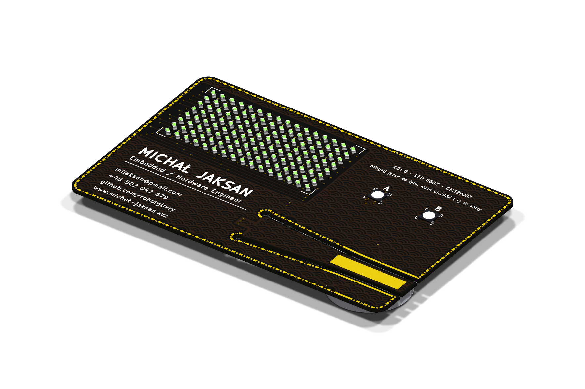
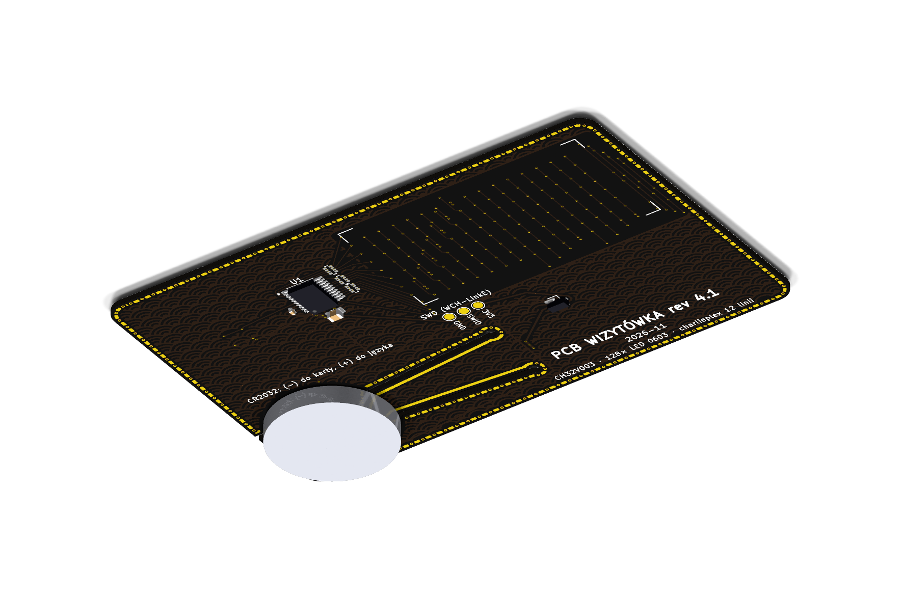
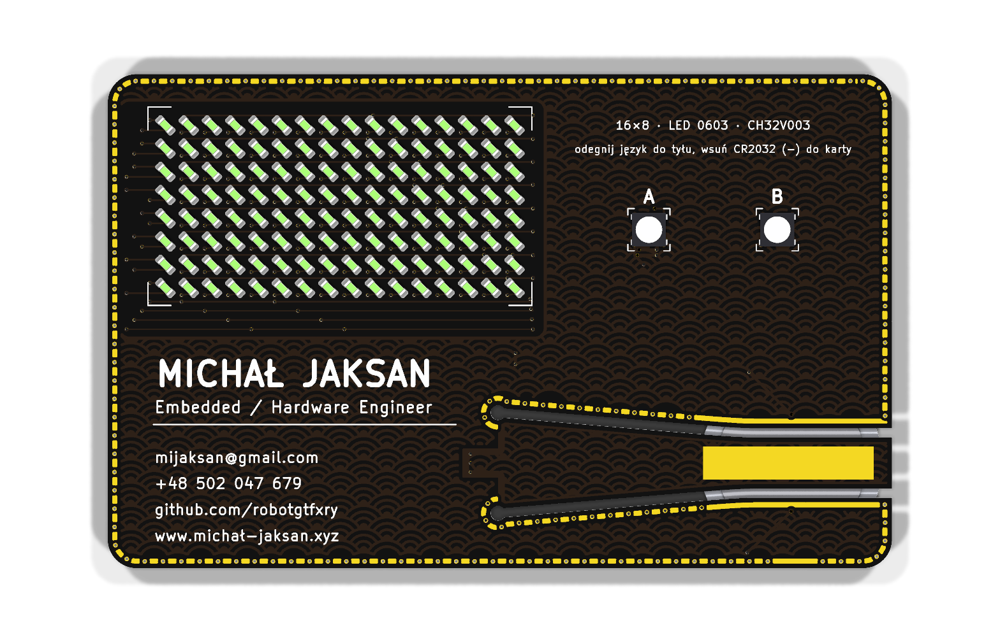
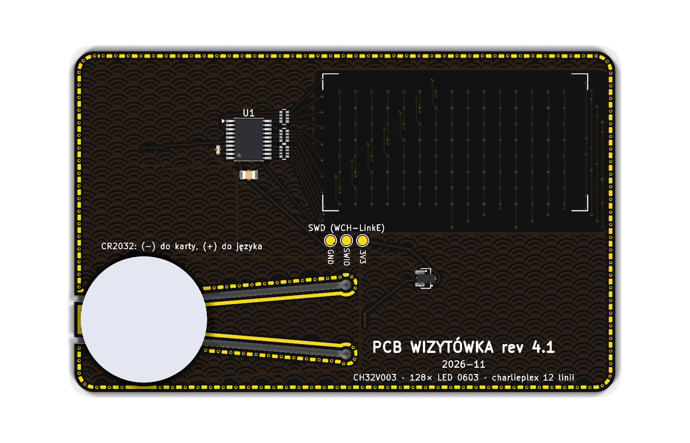

# PCB wizytówka — CH32V003 + 128 × LED 0603 (rev 4.1)

Wizytówka w formacie karty ISO (**85.6 × 54 mm**, FR4 **0.8 mm**, czarna matowa maska, ENIG):

* **front:** ekran **16 × 8 = 128 diod LED 0603**, każda obrócona o **45°**, raster 2.54 mm
  (ekran ok. **40 × 20 mm**), oraz **2 super płaskie przyciski** (A/B, 3.7 × 3.7 × **0.35 mm**),
* **tył:** **CH32V003F4P6**, 3 drabinki rezystorowe 4×33 Ω, kondensatory, P-MOSFET
  zabezpieczający przed odwrotną baterią, pady pogo SWIO,
* **CR2032 bez żadnego koszyka** — trzyma ją **widelec z jednym językiem wycięty w samej karcie**,
* **tekstura z miedzi:** wylewki GND na obu stronach mają wzór **Seigaiha** (japońskie łuski fal:
  nakładające się wachlarze koncentrycznych półokręgów, łuska o promieniu 2.54 mm = raster diod),
  widoczny pod czarną matową maską; wzór ma 0.35 mm odstępu od każdej innej sieci,
* **obrys jak w układach w.cz.:** odkryty pierścień miedzi (ENIG, 0.6 mm, 0.45 mm od krawędzi)
  na obu stronach, z płotem przelotek co 2 mm, prowadzony też wokół szczelin i języka.
  **Celowo nie jest podłączony do niczego** (nie ma sieci) — to ozdoba,
* **język pod napięciem:** przód języka to siatka Seigaiha z pełnym obrzeżem w sieci **+BATT**
  (zamiast jednej prostej ścieżki), połączona z paskiem (+) i trzema przelotkami za korzeniem,
* **okno ekranu:** pod matrycą (z obu stron) jest gładkie okno bez wzoru, obwiedzione cienką
  linią masy wtopioną we wzór; dookoła wzór dochodzi do samych ścieżek (kawałki odcięte przez
  okablowanie matrycy zostają jako pływająca miedź, zamiast zostawiać poszarpane dziury),
* **tył:** ramka z narożników nad trasowaniem matrycy, taka sama jak na froncie.

| Front (izometria) | Tył (izometria) |
|---|---|
|  |  |

| Front | Tył |
|---|---|
|  |  |

> Rendery używają prostych modeli 3D z `hardware/lib/3d` (pudełka/walce generowane przez
> `gen/models3d.py`), bo w systemie nie ma pakietu `kicad-packages3d`. Język jest na renderze
> płaski — w rzeczywistości jest odgięty za baterię.

## Uchwyt baterii: widelec z jednym językiem

```
 widok z frontu                                            widok z boku
 ┌──────────────────────────────────────────┐
 │  ramię widelca (karta)            [−pad] │             karta   ══════[−]══════
 │ ═══════════ język ═══════════[ + ]═══════  ← koniec     bateria       [██████████]
 │  ramię widelca (karta)            [−pad] │   języka    język   ═══\____[+]_______
 └──────────────────────────────────────────┘
```

* Dwie szczeliny biegną od prawej krawędzi karty w lewo. Pasek między nimi to **język**: wolny
  przy krawędzi, przyczepiony ok. 43 mm dalej (32 mm od środka ogniwa). Karta po obu stronach
  szczelin to **ramiona widelca**.
* Język jest **zwężany**: 5.6 mm pod baterią (mieści się między padami (−)), poszerza się do
  10 mm przy korzeniu. Moment gnący rośnie w stronę korzenia, a razem z nim szerokość, więc
  odkształcenie rozkłada się na całą długość i język może być krótszy. Szczeliny kończą się
  okrągłymi odciążeniami Ø1.6 mm.
* Bateria leży **płasko na tyle karty**, biegunem **(−) do karty**. Ramiona mają 2 pady (−)
  blisko środka ogniwa (r < 7 mm), czyli na denku. Brzeg tej strony ogniwa (+) leży tylko na masce.
* Język jest odgięty za baterię i odsłoniętym paskiem (+) od frontu dociska biegun (+).
  Kontakt (+) może być w dowolnym miejscu tej strony, więc nie ma tu ryzyka zwarcia — cała miedź
  na przodzie języka to i tak +BATT.
* Odkryty obrys nie biegnie tam, gdzie mógłby dotknąć ogniwa naraz po stronie (−) i (+):
  na przodzie języka i na ramionach pod ogniwem (B.Cu).
* Szacunek (`python gen/fork.py`, FR4 E ≈ 20 GPa): ugięcie języka ok. 4.3 mm, długość do
  baterii ok. 22.5 mm, odkształcenie laminatu ok. **0.91%**, docisk ok. 8.7 N.
  Płytka ma 0.8 mm właśnie po to: przy 1.6 mm tak krótki język pękałby (≈ 1.8%).

**Wkładanie:** złap koniec języka przy krawędzi karty i odegnij go do tyłu (ok. 4.5 mm),
wsuń CR2032 od prawej krawędzi między kartę a język, **(−) do karty**, i puść.

Grubość: ok. 4.0 mm na baterii, ok. 4.8 mm w miejscu języka.

## Elektronika

**Charlieplexing, 12 linii (L0…L11), 128 diod, bez pustych pól:**

* wiersze ekranu = szyny L0…L7 (F.Cu); lewy-górny pad każdej diody leży na szynie swojego wiersza,
* kolumna 0: 8 diod między liniami Q (L8…L11),
* kolumny 1–8: kolumny Q (L8…L11, każda dwa razy, w obu kierunkach),
* kolumny 9–15: klasyczne kolumny „dzielone” (pary L↔L); szyna kolumny zmienia linię na
  przekątnej i łączy się z odpowiednią szyną wiersza.

Mapa diod (ref, kolumna, wiersz, linia/pin anody i katody): `fab/card/led-map.csv`.

| Linia | L0 | L1 | L2 | L3 | L4 | L5 | L6 | L7 | L8 | L9 | L10 | L11 |
|---|---|---|---|---|---|---|---|---|---|---|---|---|
| Pin MCU | PD6 | PD5 | PD4 | PD3 | PD2 | PC7 | PC6 | PC5 | PC4 | PC3 | PC2 | PC1 |

| Funkcja | Pin |
|---|---|
| Przycisk A / B | PA1 / PA2 (do GND, włącz wewnętrzny pull-up) |
| SWIO | PD1 (pad pogo na tyle) |
| wolne | PC0, PD0, PD7/NRST |

* Każda linia ma szeregowo 33 Ω (prąd LED płynie przez dwa rezystory).
* Pobór w uśpieniu (standby + budzenie EXTI z przycisku) to ok. 10 µA, więc wyłącznik nie jest potrzebny.
* **Programowanie:** WCH-LinkE → pady pogo 3V3 / SWIO / GND (raster 2.54 mm).
  ⚠ Gdy bateria jest włożona, **nie podłączaj 3V3** — tylko SWIO + GND.

## BOM (`fab/card/card-bom.csv`)

| Ilość | Ref | Część | Strona |
|---|---|---|---|
| 128 | D1–D128 | LED 0603 **żółto-zielona 565–575 nm** (AlGaInP, Vf ≈ 2.0 V) | front |
| 2 | SW1, SW2 | tact switch **3.7 × 3.7 × 0.35 mm** z kopułką: E-Switch TL3312NF160Q / C&K PTS540 / Shou Han TS3735PA | front |
| 1 | U1 | CH32V003F4P6 (TSSOP-20) | tył |
| 3 | RN1–RN3 | drabinka 4 × 33 Ω, 4×0402 convex (YC164 / CAY16) | tył |
| 1 | C1 | 100 nF 0402 | tył |
| 1 | C2 | 22 µF 0805 6.3 V | tył |
| 1 | Q1 | AO3401A (SOT-23) | tył |
| 1 | BT1 | CR2032 (sam ogniwo, bez koszyka) | tył |

Czysta zieleń (InGaN, Vf ≈ 2.8–3.1 V) z CR2032 będzie ledwo świecić. Żółto-zielona też
wygląda na zieloną.

## Montaż (dwie strony)

1. **Front na hotplate:** pasta przez stencil (`F.Paste`), 128 diod + 2 przyciski, reflow.
   Orientacja diod: `fab/card/card-assembly-top.pdf` (Fab pokazuje katodę). Połowa diod ma
   obrót 135°, połowa −45° — to celowe, wszystkie leżą na tej samej przekątnej.
2. **Tył ręcznie / hot air** (front jest już polutowany, więc hotplate odpada): U1, RN1–RN3,
   C1, C2, Q1 — `fab/card/card-assembly-bottom.pdf`.
3. Włożenie baterii (patrz wyżej).

Pozycje i obroty obu stron: `fab/card/card-cpl.csv`.

## Zamówienie (np. JLCPCB)

`fab/card/card-gerbers.zip` — 2 warstwy, **0.8 mm**, czarna matowa maska, biały sitodruk, ENIG.
Via 0.3/0.5 mm, ścieżki ≥ 0.15 mm, prześwit 0.15 mm, szczeliny języka 1.0 mm (zwykłe frezowanie).
Wylewki mają wzór Seigaiha (linie miedzi 0.3 mm) — to celowa tekstura, nie błąd. Odkryty
obrys z przelotkami przy krawędzi jest niepodłączony (bez sieci), a kawałki wzoru odcięte przez
ścieżki matrycy też są pływające — dlatego reguła DRC „isolated copper” jest w projekcie wyłączona.
Pod przyciskami (2.3 × 3.6 mm między padami) nie ma miedzi — wymóg producenta.
Stencil tylko na front.

## Pliki i generowanie

| Ścieżka | Co to jest |
|---|---|
| `hardware/card/` | projekt KiCad 10 (`card.kicad_pro/.kicad_sch/.kicad_pcb`) |
| `hardware/lib/` | footprinty projektu (LED 0603 bez sitodruku, kontakty widelca CR2032) + modele 3D |
| `fab/card/` | Gerbery, BOM, CPL, PDF-y montażowe, schemat PDF, mapa LED |
| `gen/` | skrypty generujące wszystko powyżej |

Skrypty uruchamia się Pythonem z KiCada (moduł `pcbnew`); ścieżki do bibliotek i `kicad-cli`
szuka `gen/paths.py` (Linux, macOS, Windows):

```sh
python3 gen/card.py        # PCB (matryca, widelec z językiem, routing, wzór Seigaiha, netlista)
python3 gen/schematic.py   # schemat z netlisty PCB
python3 gen/fab.py         # Gerbery, BOM, CPL, PDF-y, rendery
```

Na Windows: `& "C:\Program Files\KiCad.0in\python.exe" gen/card.py` itd.

Weryfikacja (KiCad 10.0.7): DRC **0 / 0 niepołączonych**, ERC **0**, parity schemat ↔ PCB **0**.

Tekst na froncie zmienia się w `gen/card.py` (sekcja *silkscreen*) albo ręcznie w KiCadzie.
Po ręcznej edycji nie uruchamiaj ponownie `gen/card.py`, bo nadpisze plik.
